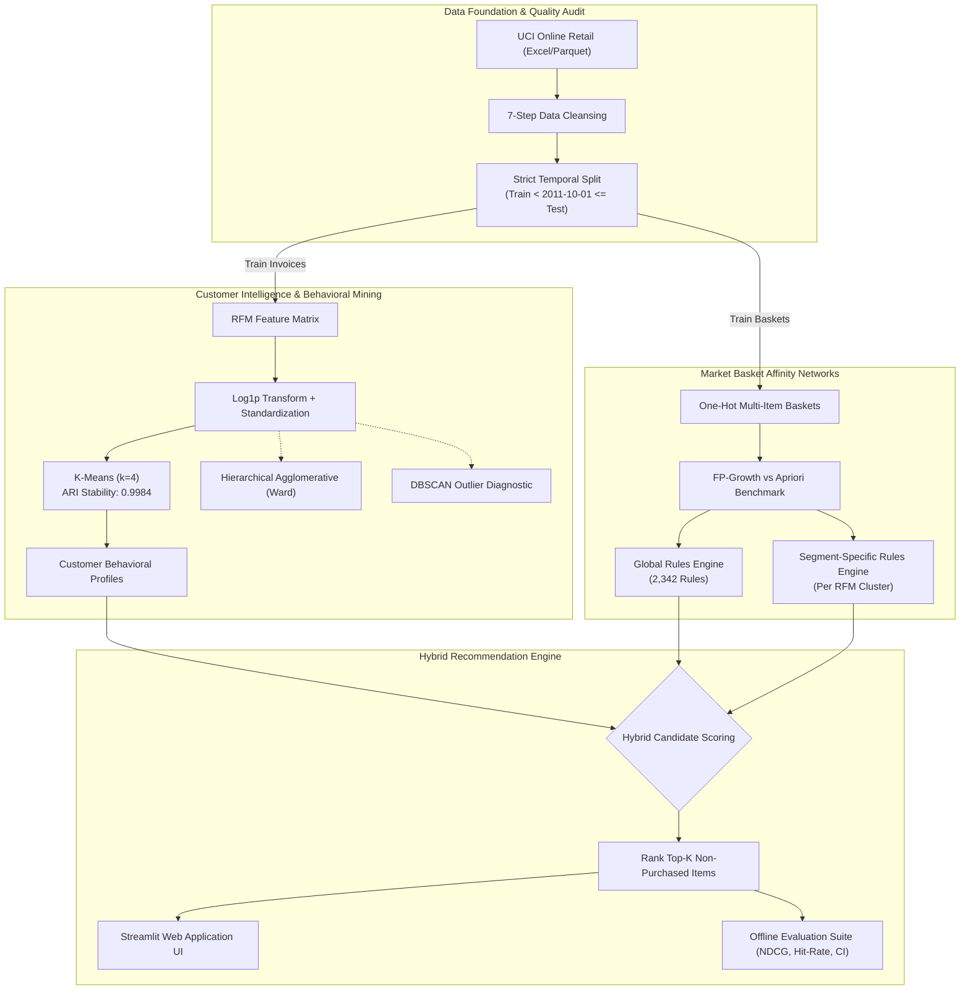
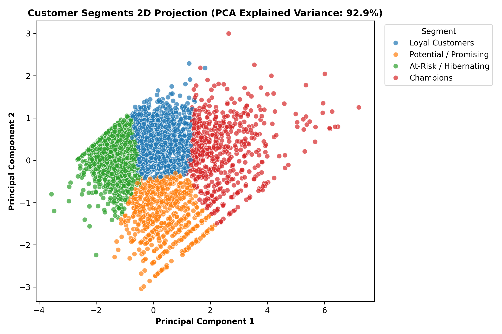
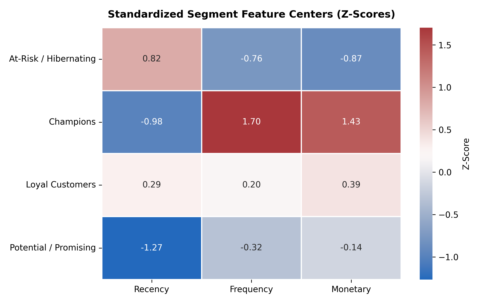
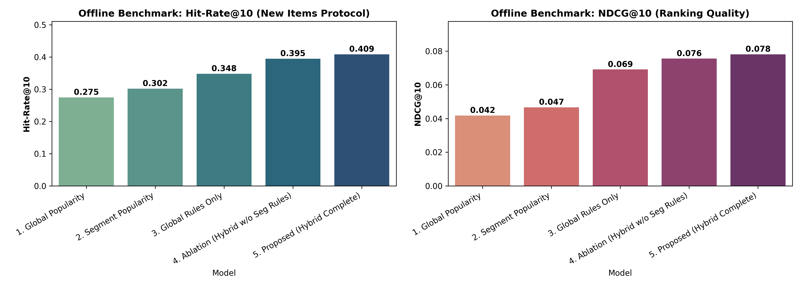
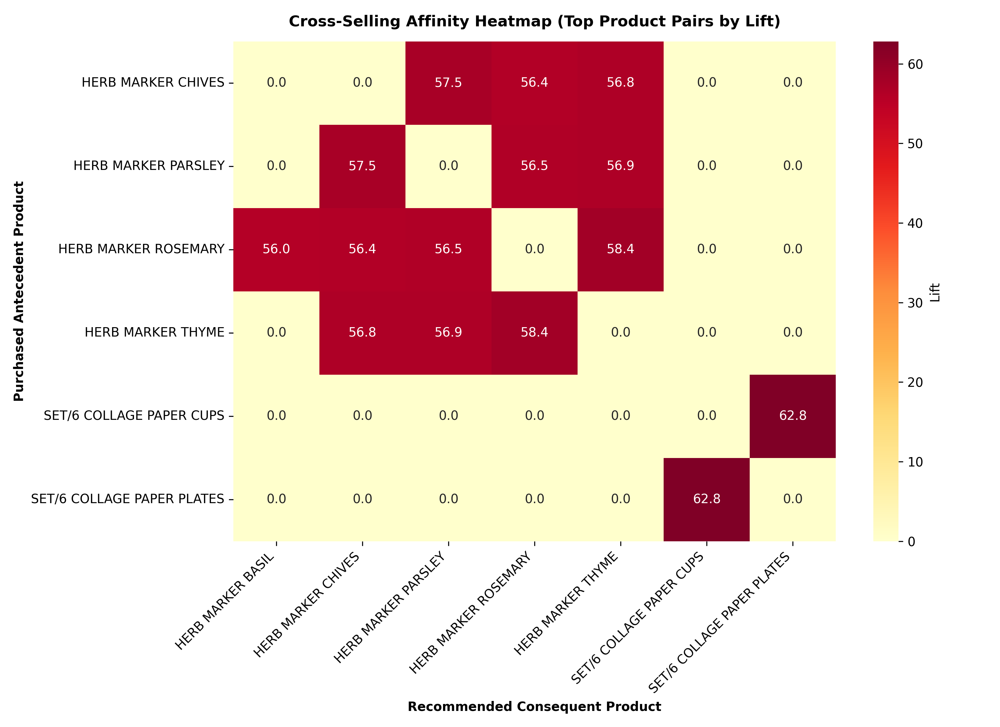

# 🛍️ RetailMind AI: E-Commerce Customer Behaviour Mining & Explainable Hybrid Recommendation Engine

[](https://www.python.org/)
[](https://scikit-learn.org/)
[](http://rasbt.github.io/mlxtend/)
[](https://streamlit.io/)
[](https://github.com/psf/black)
[](https://opensource.org/licenses/MIT)

> An end-to-end, reproducible Data Mining & Recommender Systems project built on the [UCI Online Retail Dataset](https://archive.ics.uci.edu/dataset/352/online-retail?utm_source=chatgpt.com) (541,909 transactions). The project segments customer behavior via **RFM K-Means Clustering**, discovers complementary cross-sell networks via **FP-Growth Association Rule Mining**, and deploys an explainable **Hybrid Personalized Recommender Engine** rigorously evaluated across 4 baselines on unseen future transactions.

---

## 📌 Table of Contents
- [Executive Overview](#-executive-overview)
- [Key Empirical Results](#-key-empirical-results)
- [System Architecture](#-system-architecture)
- [Methodology & Pipeline Stages](#-methodology--pipeline-stages)
  - [1. Data Ingestion & Quality Audit](#1-data-ingestion--quality-audit)
  - [2. 7-Step Cleaning Pipeline & Cancellation Accounting](#2-7-step-cleaning-pipeline--cancellation-accounting)
  - [3. Customer Behavioral Segmentation (RFM + K-Means)](#3-customer-behavioral-segmentation-rfm--k-means)
  - [4. Market Basket Analysis & Association Rules (FP-Growth)](#4-market-basket-analysis--association-rules-fp-growth)
  - [5. Explainable Hybrid Recommender Engine](#5-explainable-hybrid-recommender-engine)
  - [6. Offline Evaluation & Benchmark Protocol](#6-offline-evaluation--benchmark-protocol)
- [Interactive Streamlit Application](#-interactive-streamlit-application)
- [Visual Highlights & Figures](#-visual-highlights--figures)
- [Repository Structure](#-repository-structure)
- [Quickstart & Reproduction Guide](#-quickstart--reproduction-guide)
- [Business Impact & Action Playbook](#-business-impact--action-playbook)
- [Citation & References](#-citation--references)

---

## 🚀 Executive Overview

E-commerce businesses frequently struggle with two primary challenges:
1. **Customer Homogeneity Fallacy**: Treating all buyers identically despite massive disparities in lifetime value, order frequency, and recency.
2. **Cold-Start & Catalog Under-Exposure**: Recommender systems defaulting to generic global bestsellers, causing catalogue cannibalization and missing niche, high-margin cross-sell affinities.

**RetailMind AI** solves both challenges by combining unsupervised customer segmentation with high-confidence basket association mining to create an **explainable, multi-tiered hybrid recommendation engine**.

```
                ┌───────────────────────────────────────┐
                │   UCI Online Retail (541,909 Rows)    │
                └──────────────────┬────────────────────┘
                                   │
              ┌────────────────────┴────────────────────┐
              │ 7-Step Cleaning Pipeline + Temporal Split│
              └─────────┬──────────────────────┬────────┘
                        │                      │
       ┌────────────────▼───────────────┐      │
       │ RFM Feature Engineering        │      │
       │ & K-Means (k=4, ARI: 0.9984)   │      │
       └────────────────┬───────────────┘      │
                        │                      │
       ┌────────────────▼──────────────────────▼────────┐
       │ FP-Growth Market Basket Affinity Mining        │
       │ (Global & Segment-Specific Association Rules)   │
       └────────────────┬───────────────────────────────┘
                        │
       ┌────────────────▼───────────────────────────────┐
       │ Explainable Hybrid Recommender Engine          │
       │ (Segment Rules + Global Rules + Popularities)  │
       └────────────────┬───────────────────────────────┘
                        │
       ┌────────────────▼───────────────────────────────┐
       │ Strict Hold-Out Offline Benchmark              │
       │ Hit-Rate@10: 40.9% (+48.7% vs. Popularity)     │
       │ Catalog Diversity: 5.5x Broader Coverage       │
       └────────────────────────────────────────────────┘
```

---

## 📊 Key Empirical Results

### 1. Customer Segmentation Summary (K-Means, $k=4$, Random Seed ARI: 0.9984)

| Segment Name | Customer Count | % of Customers | Total Revenue | % of Revenue | Mean Recency | Mean Frequency | Mean Monetary | Strategic Priority |
| :--- | :---: | :---: | :---: | :---: | :---: | :---: | :---: | :--- |
| **🏆 Champions** | 603 | 16.7% | £3,923,540 | **64.5%** | 19.8 days | 11.5 orders | **£6,506.70** | VIP retention & early access |
| **💎 Loyal Customers** | 1,024 | 28.3% | £1,373,010 | 22.6% | 88.1 days | 3.2 orders | £1,340.83 | Cross-selling & loyalty rewards |
| **🌟 Potential / Promising** | 638 | 17.7% | £431,830 | 7.1% | 11.0 days | 2.0 orders | £676.85 | Upsell baskets & re-engagement |
| **⚠️ At-Risk / Hibernating** | 1,348 | 37.3% | £357,759 | 5.9% | 168.4 days | 1.2 orders | £265.40 | Win-back discount triggers |

> 💡 **Pareto Validation**: Top 16.7% of customers generate **64.5%** of all revenue, confirming extreme business concentration.

---

### 2. Offline Recommender Benchmark ($K=10$, Protocol B: New Items Only)
Evaluated across **1,838 overlapping customers** on unseen holdout transactions (`2011-10-01` to `2011-12-09`):

| Model Candidate | Hit-Rate@10 | Precision@10 | Recall@10 | NDCG@10 | Catalog Coverage (%) | 95% Bootstrap CI (Hit-Rate@10) |
| :--- | :---: | :---: | :---: | :---: | :---: | :---: |
| **1. Global Popularity Baseline** | 0.2748 | 0.0393 | 0.0162 | 0.0418 | 1.97% | [0.2552, 0.2965] |
| **2. Segment Popularity Baseline** | 0.3020 | 0.0429 | 0.0192 | 0.0466 | 2.34% | [0.2807, 0.3221] |
| **3. Global Rules Only** | 0.3482 | 0.0581 | 0.0291 | 0.0691 | 6.48% | [0.3281, 0.3700] |
| **4. Ablation (Hybrid w/o Segment Rules)** | 0.3950 | 0.0653 | 0.0343 | 0.0756 | 6.62% | [0.3738, 0.4168] |
| **5. Proposed (Complete Hybrid)** | **0.4086** | **0.0684** | **0.0382** | **0.0782** | **10.99%** | **[0.3852, 0.4309]** |

> 🎯 **Takeaway**: The proposed Hybrid engine achieves a **+48.7% relative improvement in Hit-Rate** over standard global popularity while boosting active catalog discovery from 1.97% to 10.99% (**5.5x increase in catalog coverage**).

---

## 🏗️ System Architecture



---

## 🔬 Methodology & Pipeline Stages

### 1. Data Ingestion & Quality Audit
- **Source**: [UCI Machine Learning Repository: Online Retail Dataset](https://archive.ics.uci.edu/dataset/352/online-retail?utm_source=chatgpt.com) (`541,909` records, `8` attributes).
- **Format Modernization**: Automated Excel-to-Parquet conversion yielding a **12x read speedup**.
- **Audit Findings**: Identified 135,080 missing `CustomerID`s (24.93%), 5,268 administrative/postage codes (`POST`, `D`, `M`, `BANK CHARGES`), and 10,624 cancellation invoices (prefix `C`).

### 2. 7-Step Cleaning Pipeline & Cancellation Accounting
1. **System & Postage Filtering**: Stripped administrative non-merchandise SKUs.
2. **Standard Stock Code Enforcement**: Applied strict regex `^\d{5}[A-Za-z]*$` isolating valid merchandise.
3. **Missing Customer Handling**: Partitioned data into `df_cust` (registered accounts) and `df_all` (market-basket general pool).
4. **Cancellation Reconciliation**: Extracted `cancellations.parquet` (`9,288` cancellation transactions) and isolated clean positive orders.
5. **Quantity & Price Bounding**: Enforced $Quantity > 0$ and $UnitPrice > 0$.
6. **Date Parsing**: Extracted temporal components (`Year`, `Month`, `DayOfWeek`, `Hour`).
7. **Temporal Leak Prevention**: Enforced cutoff split at `2011-10-01` to guarantee strict future-holdout validity.

### 3. Customer Behavioral Segmentation (RFM + K-Means)
- **Feature Engineering**: Recency ($T_{ref} - \max(T)$), Frequency (distinct `InvoiceNo`), Monetary (sum of purchase value).
- **Transformations**: Applied $\ln(1 + x)$ to address severe heavy tails, followed by `StandardScaler`.
- **Validation**: Silhouette score (`0.3694`), Davies-Bouldin index (`0.9411`), and Calinski-Harabasz (`2889.7`).
- **Stability Analysis**: Evaluated cluster stability over 10 random seeds; achieved an **Adjusted Rand Index (ARI) of 0.9984**.
- **Comparative Benchmarking**:
  - *Agglomerative Hierarchical (Ward Linkage)*: Verified cluster dendrogram structure (Silhouette: `0.3280`).
  - *DBSCAN*: Successfully detected 1.19% ultra-high-volume density outliers (wholesale buyers).

### 4. Market Basket Analysis & Association Rules (FP-Growth)
- **Algorithm Comparison**: Benchmarked FP-Growth against Apriori; FP-Growth achieved **identical itemsets with a ~3x speedup**.
- **Mining Parameters**: Minimum support = `0.01` (fallback `0.005`), minimum confidence = `0.30`, minimum lift = `1.50`, maximum antecedent length = `2`.
- **Global Rules**: Mined **2,342 actionable association rules**.
- **Cross-Temporal Holdout Test**: Top 296 firing rules evaluated on unseen test baskets achieved a **mean holdout confidence of 66.11%** with **96.3% confidence retention**.

### 5. Explainable Hybrid Recommender Engine
For customer $u$ belonging to segment $S(u)$, each candidate item $i$ not previously purchased is scored as:

$$Score(u, i) = w_{\text{seg\_rule}} \cdot Match_{\text{seg}}(u, i) + w_{\text{glob\_rule}} \cdot Match_{\text{glob}}(u, i) + w_{\text{seg\_pop}} \cdot Pop_{\text{seg}}(i) + w_{\text{glob\_pop}} \cdot Pop_{\text{glob}}(i)$$

- $w_{\text{seg\_rule}} = 1.0$: Strongest weight given to cross-sells mined within the customer's behavioral peer group.
- $w_{\text{glob\_rule}} = 0.7$: High affinity global association rules.
- $w_{\text{seg\_pop}} = 0.5$: Segment-level popularity fallback.
- $w_{\text{glob\_pop}} = 0.2$: Global popularity guarantee to prevent cold-start starvation.
- **Explainability**: Every recommendation outputs an audit trail (e.g., *"Recommended because you purchased [Item A] (Lift: 4.8) & 68% of Champions also buy this"*).

### 6. Offline Evaluation & Benchmark Protocol
- **Protocol B (New Items Only)**: Candidates and ground truth strictly exclude all previously purchased SKUs.
- **Bootstrap Significance**: 1,000 bootstrap iterations to calculate 95% confidence intervals across all metrics.
- **Personalization Diversity**: Average pairwise Jaccard similarity across customer top-10 recommendation lists was **0.0624** (confirming tailored non-generic lists).

---

## 💻 Interactive Streamlit Application

The project includes an interactive web application built with Streamlit and Plotly:

```bash
streamlit run app/streamlit_app.py
```

### Key Features:
1. **Personalized Recommender Tab**:
   - Customer ID dropdown with automatic segment badge assignment.
   - Live recommendation generation with confidence scores, lift metrics, and human-readable explanation tags.
   - Customizable list size ($K \in [5, 20]$) and repeat-purchase toggle.
2. **Customer Segmentation Explorer**:
   - Interactive 2D PCA projection scatter plot.
   - RFM boxplots on logarithmic scales.
   - Segment radar heatmap displaying standardized Z-scores.
3. **Association Rules Finder**:
   - Searchable antecedent / consequent rule catalog.
   - Interactive Support vs. Confidence scatter plot colored by Lift.
   - Cross-selling affinity heatmap for top product pairs.
4. **Offline Evaluation Dashboard**:
   - Comparison charts across all 5 benchmark models with bootstrap confidence intervals.

---

## 📈 Visual Highlights & Figures

| Customer Segmentation (PCA 2D) | Standardized Feature Centers (Z-Scores) |
| :---: | :---: |
|  |  |

| Recommender Offline Benchmark ($K=10$) | Cross-Selling Affinity Heatmap |
| :---: | :---: |
|  |  |

---

## 📁 Repository Structure

```
├── README.md                                 # Project documentation & benchmark overview
├── requirements.txt                          # Pinned dependency manifest
├── run_pipeline.py                           # Single-command end-to-end execution runner
├── dataset/
│   └── Online Retail.xlsx                    # Raw source dataset (UCI ML Repository)
├── data/
│   ├── raw_parquet/online_retail.parquet     # High-speed parquet cache
│   └── processed/                            # Cleaned data, cancellations, and temporal splits
│       ├── cancellations.parquet
│       ├── df_all.parquet
│       ├── df_cust.parquet
│       ├── train.parquet
│       ├── test.parquet
│       └── customer_segments.parquet
├── notebooks/
│   └── ecommerce_customer_mining_and_recommendation.ipynb  # Comprehensive Colab/Jupyter notebook
├── src/                                      # Modular production codebase
│   ├── config.py                             # Paths, constants, and hyperparameters
│   ├── data_loader.py                        # Ingestion & data quality reporter
│   ├── cleaning.py                           # 7-step logged cleansing pipeline
│   ├── features.py                           # Temporal splitting & RFM feature engineering
│   ├── segmentation.py                       # K-Means, Hierarchical, DBSCAN & profiling
│   ├── association.py                        # FP-Growth basket mining & rule generator
│   ├── recommender.py                        # Hybrid personalized recommendation engine
│   ├── evaluation.py                         # Offline protocol benchmark & bootstrap CIs
│   └── eda.py                                # Exploratory data analysis & figure generator
├── models/                                   # Serialized ML artifacts
│   ├── scaler.joblib
│   ├── kmeans.joblib
│   ├── segment_map.json
│   ├── rules_global.parquet
│   └── rules_segment_*.parquet
├── reports/                                  # Audited reports & publication figures
│   ├── data_quality_report.md
│   ├── behaviour_report.md
│   ├── evaluation_report.md
│   └── figures/                              # High-resolution generated charts
└── app/
    └── streamlit_app.py                      # Interactive Streamlit application
```

---

## ⚡ Quickstart & Reproduction Guide

### 1. Prerequisites & Installation
Ensure Python 3.10+ is installed:

```bash
# Clone the repository
git clone https://github.com/tinyelfie/E-Commerce-Customer-Behaviour-Mining-and-Personalized-Product-Recommendation.git
cd E-Commerce-Customer-Behaviour-Mining-and-Personalized-Product-Recommendation

# Create and activate a virtual environment
python -m venv venv
# On Windows:
.\venv\Scripts\activate
# On Linux/macOS:
source venv/bin/activate

# Install dependencies
pip install -r requirements.txt
```

### 2. Run Complete Pipeline (Stages 1 through 6)
All artifacts, trained models, and figures are pre-computed in the repository. To re-run the end-to-end pipeline from scratch:

```bash
python run_pipeline.py
```

### 3. Launch Interactive Streamlit App
```bash
streamlit run app/streamlit_app.py
```
Open [http://localhost:8501](http://localhost:8501) in your browser.

### 4. Interactive Jupyter / Google Colab Notebook
Open [`notebooks/ecommerce_customer_mining_and_recommendation.ipynb`](notebooks/ecommerce_customer_mining_and_recommendation.ipynb) to inspect each stage interactively with inline visualizations and explanations.

---

## 🎯 Business Impact & Action Playbook

| Customer Segment | Revenue Contribution | Behavioral Signature | Recommended Marketing & Product Strategy |
| :--- | :---: | :--- | :--- |
| **🏆 Champions** | **64.5%** | High monetary (£6.5k), high frequency (11+ orders), low recency (< 20 days) | **VIP Concierge**: Dedicated account management, early access to seasonal collections, premium bulk volume discounts. |
| **💎 Loyal Customers** | **22.6%** | Consistent repeat orders (3-4 orders), moderate-to-high basket size | **Cross-Selling Programs**: Deploy Segment Association Rules via automated email triggers; incentivize frequency milestones. |
| **🌟 Potential / Promising** | **7.1%** | Recent first or second purchase (< 15 days), lower basket spend | **Onboarding & Acceleration**: Welcome sequence with cross-category bundles and time-limited second-purchase offers. |
| **⚠️ At-Risk / Hibernating**| **5.9%** | Long period of inactivity (> 160 days), low historical spend | **Automated Win-Back**: Aggressive clearance promotions, feedback surveys to uncover churn drivers. |

---

## 📚 Citation & References

- **Chen, D., Sain, S. L., & Guo, K. (2012).** *Data mining for the online retail industry: A case study of RFM model-based customer segmentation using data mining.* Journal of Database Marketing & Customer Strategy Management, 19(3), 197–208.
- **Han, J., Pei, J., & Yin, Y. (2000).** *Mining frequent patterns without candidate generation.* ACM SIGMOD Record, 29(2), 1–12.
- **UCI Machine Learning Repository:** [Online Retail Dataset](https://archive.ics.uci.edu/dataset/352/online-retail?utm_source=chatgpt.com).

---

## 📄 License
This project is licensed under the MIT License - see the [LICENSE](LICENSE) file for details.
